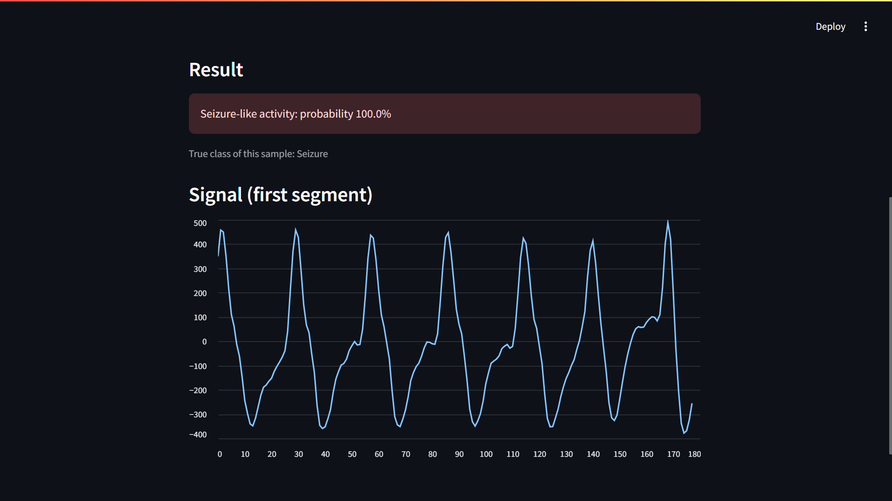
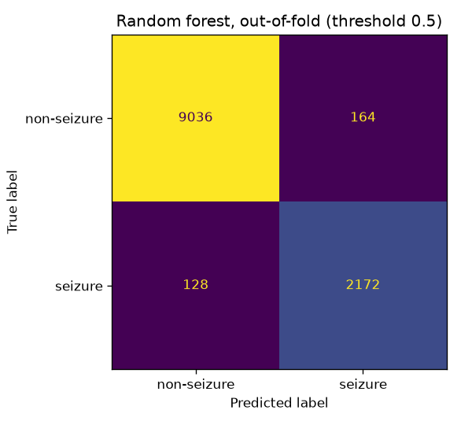
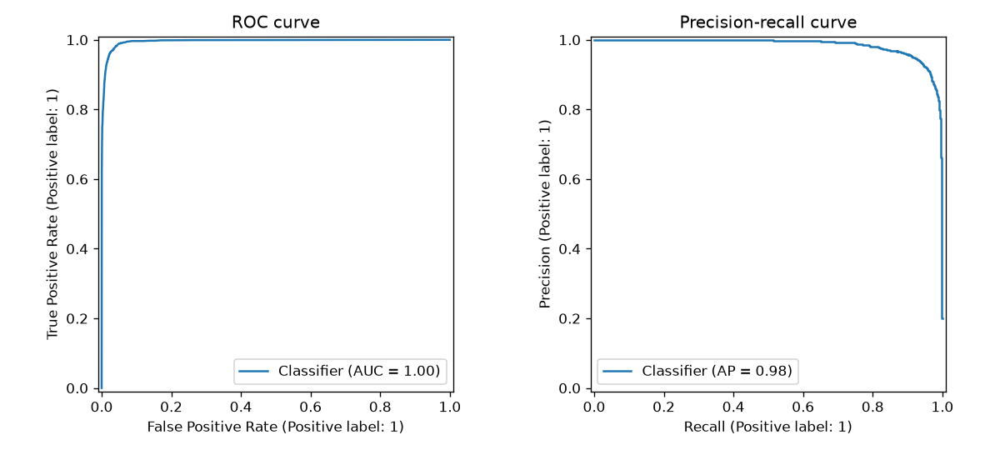
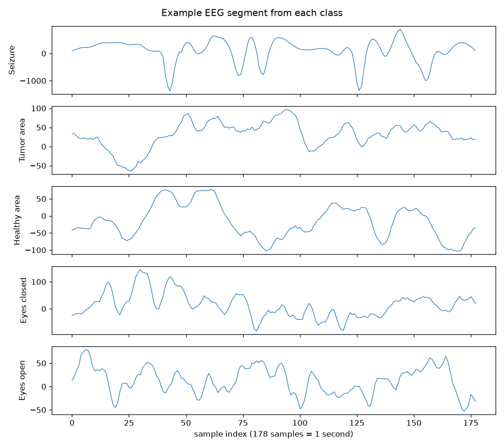

# biomed-ml

An extensible machine learning framework for biomedical data. Datasets,
feature extractors, models and experiments are separate modules, and an
experiment is just a small YAML file. The first module detects epileptic
seizures in EEG segments.



## Results: seizure vs. non-seizure EEG

The Bonn dataset has 11,500 one-second EEG segments (178 samples each) cut
from 500 recordings, in five classes with 2,300 segments each. Class 1 is
seizure activity and classes 2-5 are non-seizure, so the binary task is 20%
positive.

Evaluation: 5-fold `StratifiedGroupKFold` (seed 42), where all segments of
one recording stay on the same side of the split. Precision, recall and F1
are for the seizure class. Values are the mean over the 5 folds.

| Model | Accuracy | Precision | Recall | F1 | ROC-AUC |
|---|---|---|---|---|---|
| Random forest | 0.9748 | 0.9312 | 0.9443 | 0.9376 | 0.9951 |
| Logistic regression | 0.9673 | 0.8940 | 0.9526 | 0.9217 | 0.9915 |

Accuracy alone is misleading here: a model that always answers "no seizure"
already gets 0.80 accuracy with zero recall.




### Why the split matters

Every recording is cut into 23 segments. A plain random split puts segments
of the same recording in both train and test, which inflates the score:

| Random forest | F1 | ROC-AUC |
|---|---|---|
| Group-aware split (used for all results) | 0.9376 | 0.9951 |
| Plain random split (leaky) | 0.9580 | 0.9977 |



## How it works

1. `BonnEEGDataset` reads the raw `.mat` files and cuts each signal into
   178-sample segments (about 1 second at 173.61 Hz).
2. Feature extractors turn each segment into 21 numbers:
   - 10 time-domain statistics: mean, std, min, max, peak-to-peak, RMS,
     skewness, kurtosis, line length, zero crossings
   - 11 spectral features from a Welch spectrum: absolute and relative power
     in the delta, theta, alpha, beta and gamma bands, plus the dominant
     frequency
3. A scikit-learn model is trained and evaluated with group-aware cross
   validation.
4. A Streamlit app loads the trained model and scores an uploaded signal or a
   local sample.

## Project structure

```
src/biomed/
    datasets/      one class per dataset (BaseDataset contract)
    features/      one class per feature extractor
    models/        model registry
    evaluation/    group-aware cross validation, out-of-fold predictions
    pipeline.py    runs an experiment described by a YAML config
    train.py       trains the final model on all data
    inference.py   parsing and prediction helpers for the app
configs/           experiment configs (eeg_rf.yaml, eeg_logreg.yaml)
app/               Streamlit demo
notebooks/         data exploration, features, modeling, evaluation
tests/             pytest suite
scripts/           health check and figure generation
models/            trained demo model
```

## Quick start

```
git clone https://github.com/TahaAbbasi211/biomed-ml.git
cd biomed-ml
pip install -r requirements.txt
pip install -e .
```

The raw data is not included. Download the five zip files (Z, O, N, F, S) of
the Bonn EEG time series from the University of Bonn, Department of
Epileptology, and extract them so that each folder contains `.mat` files:

```
data/eeg/raw/Z/  data/eeg/raw/O/  data/eeg/raw/N/
data/eeg/raw/F/  data/eeg/raw/S/
```

Folder to label mapping: S=1 (seizure), F=2, N=3, O=4, Z=5.

Run an experiment, train the final model, start the app and run the tests:

```
python -m biomed.pipeline configs/eeg_rf.yaml
python -m biomed.train configs/eeg_rf.yaml
streamlit run app/streamlit_app.py
python -m pytest
```

Results of an experiment are written to `outputs/<experiment>/`. The repository
includes a trained model in `models/` (scikit-learn 1.9.1); if it fails to load
with another version, retrain it with the command above. The app can also be
used without the raw data through its upload option.

## Extending the framework

| To add | Do this |
|---|---|
| An experiment | add a YAML file to `configs/` |
| A model | add one entry to `MODELS` in `models/sklearn_models.py` |
| A feature set | add a class in `features/` and register it in `FEATURES` in `pipeline.py` |
| A dataset | add a class in `datasets/` and register it in `DATASETS` in `pipeline.py` |

## Limitations

- The data files carry no subject identifiers, so splits are grouped by
  recording, not by person. Recordings from the same person may appear on both
  sides of a split, so the numbers may be optimistic for completely new
  patients.
- Results come from a single cross-validation split (fixed seed) and no
  standard deviation across folds is reported yet.
- The final demo model is trained on all data, so its score on this dataset
  says nothing about performance. Use the cross-validation table above.
- This is a benchmark dataset with clean, short segments, which is much easier
  than clinical EEG.

## Roadmap

- Add the heart disease (tabular) and ECG modules from my earlier projects
- Add a 1D CNN model and compare it with the classical models
- Report variability across folds and repeated splits

## Data and citation

Andrzejak RG, Lehnertz K, Mormann F, Rieke C, David P, Elger CE (2001).
Indications of nonlinear deterministic and finite-dimensional structures in
time series of brain electrical activity: Dependence on recording region and
brain state. Physical Review E 64, 061907.
